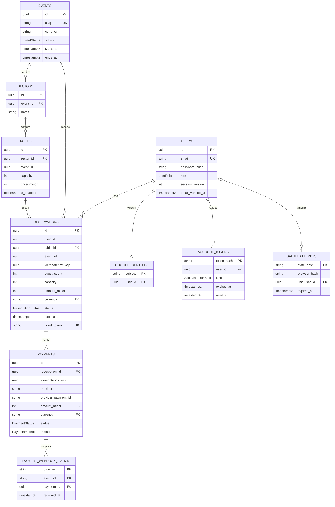

# Modelo relacional

## Restrições de negócio

- As FKs compostas de `tables` e `reservations` garantem que setor, mesa e reserva se refiram ao mesmo evento. A moeda da reserva segue a moeda do evento.
- A FK composta de `payments` exige o mesmo valor e a mesma moeda da reserva. Os valores monetários usam inteiros na menor unidade da moeda. Cada reserva pode ter várias tentativas e no máximo uma liquidação, incluindo uma liquidação já estornada.
- Um índice parcial admite somente uma cobrança de checkout pendente por reserva. A chave composta em `payment_webhook_events` garante a deduplicação por provedor. Uma aprovação tardia é registrada em `REFUND_REQUIRED`; somente uma liquidação elegível confirma a reserva e torna a mesa `SOLD`.
- O índice parcial `reservations_one_active_per_table` admite uma única reserva `PENDING_PAYMENT` ou `CONFIRMED` por mesa. O worker registra `EXPIRED` quando o prazo de pagamento passa. A transação de uma nova reserva também pode expirar o bloqueio vencido antes de inserir outro.
- O bloqueio compartilhado do evento protege a leitura de status, início e moeda. O bloqueio exclusivo da linha da mesa serializa a alocação daquela mesa. Rotinas futuras que bloqueiem ambas as linhas podem usar a mesma ordem, evento antes da mesa.
- As FKs operacionais restringem exclusões que quebrariam o histórico. As FKs de tokens e identidades removem registros de autenticação dependentes quando a conta é excluída.
- O [DDL](../prisma/migrations/20261122000000_initial/migration.sql) contém as chaves compostas, as restrições `CHECK` e os índices parciais. [Índices parciais no PostgreSQL](https://www.postgresql.org/docs/current/indexes-partial.html)
